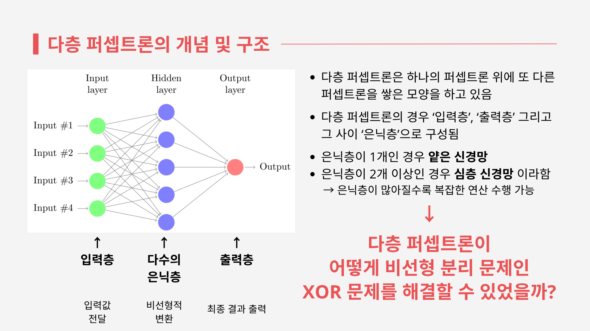
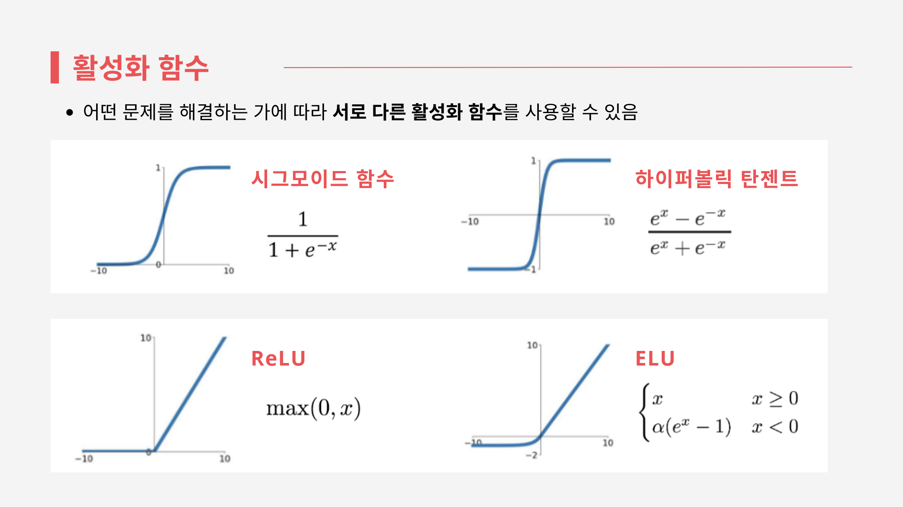

# 다층 퍼셉트론 조사 보고서

## 보고서 소개

인공지능 입문 과목에서 작성한 다층 퍼셉트론(Multilayer Perceptron, MLP) 조사 보고서입니다. 단층 퍼셉트론이 해결하지 못하는 XOR 문제를 출발점으로, 은닉층과 활성화 함수가 필요한 이유를 살펴보고 역전파를 이용한 가중치 학습 과정까지 정리했습니다.

신경망 구조도, 논리 연산 예시, 활성화 함수 그래프를 함께 담았습니다. 개념과 동작 원리를 설명하는 PDF 자료이며, 별도의 구현 코드나 학습 실험은 포함하지 않습니다.

- 과목: 인공지능 입문
- 분량: PDF 16쪽

## 주요 내용

### 1. 단층 퍼셉트론의 한계와 XOR 문제

단층 퍼셉트론은 입력에 가중치를 적용하고 활성화 함수를 거쳐 결과를 출력합니다. 보고서는 선형 분리가 가능한 경우와 XOR처럼 하나의 직선으로 나눌 수 없는 경우를 비교하며, 은닉층이 필요한 배경을 설명합니다.

XOR 예시에서는 은닉층이 NAND와 OR 연산을 수행하고, 출력층이 두 결과를 AND 연산으로 결합합니다. 여러 퍼셉트론을 연결해 단층으로 처리할 수 없던 문제를 표현하는 과정을 보여 줍니다.

### 2. 은닉층과 비선형 활성화 함수

입력층은 데이터를 전달하고, 은닉층은 변환을 수행하며, 출력층은 최종 결과를 만듭니다. 선형 변환만 여러 번 쌓아도 전체는 선형 변환이므로, 비선형 문제를 표현하려면 활성화 함수가 필요합니다.

보고서는 다음 네 함수를 그래프와 함께 비교합니다.

| 함수 | 동작 | 보고서에서 다루는 특징 |
|---|---|---|
| Sigmoid | 입력을 0과 1 사이로 변환 | 출력 범위와 기울기 소실 |
| Tanh | 입력을 -1과 1 사이로 변환 | 원점 중심의 출력과 기울기 소실 |
| ReLU | 양수는 그대로, 0 이하는 0으로 출력 | 단순한 계산과 Dying ReLU |
| ELU | 양수는 그대로, 음수는 지수 함수로 변환 | 음수 영역의 포화와 지수 연산 비용 |

### 3. 순전파와 역전파

입력에서 예측값을 구한 뒤, 예측값과 목표값의 차이로 손실을 계산합니다. 역전파는 출력층에서 앞쪽 층으로 계산을 이어 가며 각 가중치에 대한 손실의 기울기를 구하고, 이 기울기를 이용해 가중치를 갱신합니다.

보고서는 **순전파 → 손실 계산 → 역전파 → 가중치 갱신**의 흐름을 도식과 수식으로 설명합니다. 마지막에는 깊은 신경망의 학습에서 나타날 수 있는 기울기 소실과 전역 최솟값 수렴을 보장할 수 없다는 한계도 다룹니다.

## 목차

| 페이지 | 내용 |
|:---:|---|
| 1–2 | 표지와 목차 |
| 3–4 | 단층 퍼셉트론과 XOR 문제 |
| 5–6 | 다층 퍼셉트론의 구조와 XOR 연산 예시 |
| 7 | 선형 변환과 비선형 활성화 함수의 필요성 |
| 8–12 | Sigmoid, Tanh, ReLU, ELU 비교 |
| 13–15 | 순전파, 역전파, 가중치 갱신과 한계 |
| 16 | 마무리 |

[**다층 퍼셉트론 조사 보고서 원문 보기**](다층%20퍼셉트론%20조사%20보고서.pdf)
