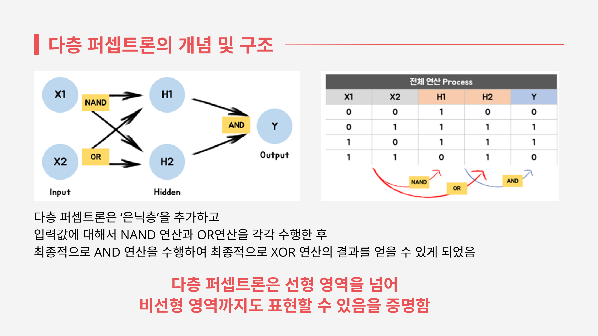

  
# 다층 퍼셉트론 발표 자료

인공지능 입문 수업에서 다층 퍼셉트론(Multilayer Perceptron, MLP)을 조사해 발표한 자료입니다. 단층 퍼셉트론의 한계에서 출발해, 은닉층과 활성화 함수가 필요한 이유를 살펴보고 역전파를 이용한 학습 과정까지 정리했습니다.

발표는 XOR 문제를 통해 다층 구조의 필요성을 설명한 뒤, 신경망의 구성과 비선형 연산, 활성화 함수의 특징, 가중치를 학습하는 방법으로 이어집니다. 아래에는 각 주제에서 조사한 내용을 실제 발표 슬라이드와 함께 소개했습니다.

## Contents

- [단층 퍼셉트론과 XOR](#단층-퍼셉트론과-xor)
- [다층 퍼셉트론의 구조](#다층-퍼셉트론의-구조)
- [활성화 함수](#활성화-함수)
- [순전파와 역전파](#순전파와-역전파)
- [발표 자료](#발표-자료)

## 단층 퍼셉트론과 XOR

다층 퍼셉트론의 등장 배경을 설명하기 위해 먼저 단층 퍼셉트론을 살펴봤습니다. 퍼셉트론은 입력에 가중치를 적용해 합한 뒤 활성화 함수를 거쳐 결과를 출력합니다. 단층 퍼셉트론은 입력을 하나의 직선으로 구분할 수 있는 문제를 표현하지만, XOR처럼 그렇게 나눌 수 없는 문제에는 한계가 있습니다.

XOR은 두 입력이 서로 다를 때만 1을 출력하는 연산입니다. 발표에서는 이 문제를 NAND와 OR, AND 연산으로 나눠 설명했습니다. 은닉층에서 같은 입력에 대한 NAND와 OR의 결과를 각각 구한 뒤, 출력층에서 두 결과를 AND로 결합하면 XOR의 출력을 얻습니다.

*발표 자료 6쪽 — 은닉층의 NAND·OR 결과를 출력층에서 AND로 결합하는 과정*

슬라이드 왼쪽에는 입력에서 은닉층을 거쳐 출력에 이르는 연결을, 오른쪽에는 네 가지 입력 조합에 대한 중간값과 최종 결과를 담았습니다. 이를 통해 여러 퍼셉트론을 연결했을 때 단층에서 표현하지 못했던 XOR을 어떻게 표현할 수 있는지 설명했습니다.

## 다층 퍼셉트론의 구조

*발표 자료 5쪽 — 다층 퍼셉트론의 구조*

다층 퍼셉트론은 입력값을 전달하는 입력층, 중간 연산을 수행하는 은닉층, 최종 결과를 내보내는 출력층으로 구성됩니다. 구조도는 각 층의 뉴런이 다음 층으로 연결되는 모습을 보여 줍니다. 발표에서는 이 연결 관계와 각 층의 역할을 정리하고, 은닉층을 추가한 구조를 앞서 살펴본 XOR 예시와 연결했습니다.

이어서 층의 수를 늘리는 것만으로 비선형 문제를 표현할 수 있는지 살펴봤습니다. 선형 연산만 여러 번 수행하면 전체 관계도 선형으로 남기 때문에, 층을 쌓는 것과 함께 비선형 변환이 필요합니다. 각 층의 계산 결과를 활성화 함수로 변환하는 이유를 설명하고, 다음 주제에서 실제 함수들의 형태와 특징을 비교했습니다.

## 활성화 함수

활성화 함수는 뉴런이 계산한 값을 다음 층으로 전달할 때 어떤 형태로 변환할지 결정합니다. 발표에서는 Sigmoid, Tanh, ReLU, ELU를 조사했습니다. 각 함수의 그래프와 수식을 통해 출력 범위와 음수 입력을 처리하는 방식이 어떻게 다른지 살펴봤습니다.

*발표 자료 8쪽 — 출력 범위와 음수 영역의 모양이 다른 네 가지 활성화 함수*

| 함수 | 입력의 변환 | 조사한 특징 |
|---|---|---|
| Sigmoid | 입력을 0과 1 사이의 값으로 변환 | 절댓값이 큰 입력에서 기울기가 작아지는 현상 |
| Tanh | 입력을 -1과 1 사이의 값으로 변환 | 원점을 중심으로 한 출력과 기울기 소실 |
| ReLU | 양수는 그대로 출력하고 0 이하는 0으로 변환 | 단순한 계산과 음수 영역의 기울기가 0이라는 특성 |
| ELU | 양수는 그대로 출력하고 음수는 지수 함수로 변환 | 음수 영역의 포화 특성과 지수 연산 비용 |

함수의 차이는 출력의 모양뿐 아니라 학습에도 영향을 줍니다. Sigmoid와 Tanh는 입력이 포화 영역에 들어가면 기울기가 작아지는 문제가 있고, ReLU는 뉴런이 계속 음수 영역에 머무를 때 학습이 멈추는 Dying ReLU 문제가 생길 수 있습니다. 발표에서는 이러한 문제와 함께 음수 영역에도 출력을 갖는 ELU의 특징을 살펴보며, 활성화 함수별 장점과 한계를 정리했습니다.

## 순전파와 역전파

마지막으로 신경망이 결과를 계산하는 과정에서 가중치를 학습하는 과정으로 설명을 이어 갔습니다. 순전파는 현재 가중치로 입력에 대한 예측값을 구하는 과정입니다. 역전파는 예측값으로 계산한 손실을 바탕으로 각 가중치에 대한 손실의 기울기를 구하는 과정이며, 이 기울기를 이용해 가중치를 갱신합니다.

발표에서는 학습 과정을 다음 네 단계로 정리했습니다.

1. **순전파**: 입력을 각 층의 가중치 연산과 활성화 함수에 통과시켜 예측값을 구합니다.
2. **손실 계산**: 예측값과 목표값을 비교해 오차를 손실로 나타냅니다.
3. **역전파**: 출력층에서 앞쪽 층으로 계산을 이어 가며 각 가중치에 대한 손실의 기울기를 구합니다.
4. **가중치 갱신**: 계산한 기울기와 학습률을 이용해 가중치를 조정합니다.

이 흐름을 통해 예측값을 만드는 연산과 가중치를 조정하기 위한 계산을 구분하고, 역전파가 신경망 학습에서 맡는 역할을 설명했습니다. 이어서 경사 하강법이 항상 전역 최솟값에 도달한다는 보장은 없다는 점과, 깊은 신경망에서 기울기가 작아져 앞쪽 층의 가중치가 충분히 갱신되지 않을 수 있다는 한계를 다루며 발표를 마무리했습니다.

## 발표 자료

전체 발표 자료는 16쪽 분량의 PDF입니다. 단층 퍼셉트론과 XOR 문제부터 활성화 함수별 설명, 순전파와 역전파의 도식 및 가중치 갱신 수식까지 확인할 수 있습니다.

[발표 자료 PDF 보기](https://github.com/JuggernautSensei/Research-Report-on-Multilayer-Perceptrons/blob/main/%EB%8B%A4%EC%B8%B5%20%ED%8D%BC%EC%85%89%ED%8A%B8%EB%A1%A0%20%EC%A1%B0%EC%82%AC%20%EB%B3%B4%EA%B3%A0%EC%84%9C.pdf)
