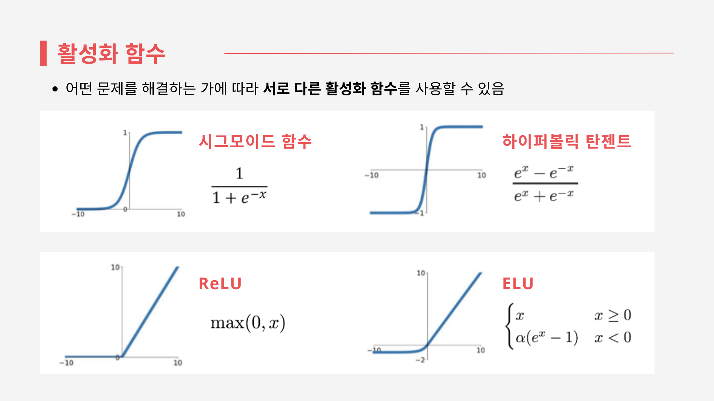

<h1 align="center">다층 퍼셉트론 발표 자료</h1>

XOR 예제로 다층 퍼셉트론의 구조와 학습 과정을 설명한 발표 자료

## 목차

* [프로젝트 소개](#프로젝트-소개)
* [은닉층과 XOR](#은닉층과-xor)
* [활성화 함수](#활성화-함수)
* [역전파](#역전파)
* [발표 자료](#발표-자료)

## 프로젝트 소개

부경대학교 인공지능 입문 수업에서 다층 퍼셉트론(MLP)을 조사해 16쪽 분량의 자료로 발표했습니다. XOR을 예로 들어 은닉층과 비선형 활성화 함수가 어떤 역할을 하는지 설명하고, 목표 출력과 예측의 차이로 각 층의 가중치를 학습하는 과정을 다뤘습니다.

## 은닉층과 XOR

입력이 두 개인 단층 퍼셉트론의 결정 경계는 직선 하나입니다. XOR에서 같은 출력을 내는 입력 쌍은 각각 대각선에 놓여, 직선 하나로 출력이 0인 점과 1인 점을 분리할 수 없습니다. 다층 퍼셉트론은 입력층과 출력층 사이에 은닉층을 두어 여러 판단을 조합합니다.

은닉층의 두 뉴런이 같은 입력으로 각각 NAND와 OR를 계산하고, 출력층이 두 값을 AND로 결합합니다. 두 입력이 모두 1이면 NAND가 0이 되고, 모두 0이면 OR가 0이 됩니다. 두 입력이 서로 다를 때만 두 값이 모두 1이므로 XOR의 출력도 1입니다.

가중합과 편향만 사용하는 층을 여러 개 쌓아도 결국 하나의 가중합과 편향으로 표현할 수 있습니다. 위 예제처럼 판단 경계를 조합하려면 층의 출력에 비선형 활성화 함수를 적용해야 합니다.

## 활성화 함수

네 활성화 함수의 출력과 기울기를 비교했습니다.

| 함수 | 출력 특성 | 학습에 미치는 영향 |
| --- | --- | --- |
| Sigmoid | 0과 1 사이 | 입력의 절댓값이 크면 양 끝에서 포화되어 기울기가 작아짐 |
| Tanh | −1과 1 사이, 원점 대칭 | 출력의 중심은 0이고, 양 끝에서는 기울기가 작아짐 |
| ReLU | 양수는 그대로, 0 이하는 0 | 음수 구간의 기울기가 0이라 그 구간에 머문 뉴런이 학습을 멈출 수 있음(Dying ReLU) |
| ELU | 양수는 그대로, 음수는 지수 함수에 따라 포화 | 음수 구간에서도 유한한 입력에는 기울기가 있고, 지수 연산 비용이 듦 |

Sigmoid와 Tanh의 평평한 구간처럼 작은 미분값이 역전파 과정에서 거듭 곱해지면, 입력층에 가까운 층에 전달되는 기울기가 작아집니다. 이 기울기 소실로 앞쪽 층의 가중치가 거의 바뀌지 않을 수 있습니다.

## 역전파

1. **순전파.** 각 뉴런은 입력의 가중합에 활성화 함수를 적용합니다. 그림에서는 출력층의 두 예측값을 각각 목표값과 비교해 전체 손실을 구합니다.
2. **역전파.** 출력층에서 입력층 쪽으로 거슬러 가며 연쇄법칙으로 손실을 각 가중치로 미분합니다. 그림의 은닉 뉴런은 두 출력에 모두 연결되어 있으므로, 이 뉴런에 들어오는 가중치의 기울기에는 두 출력 경로의 기여가 합쳐집니다.
3. **가중치 갱신.** 경사 하강법으로 각 가중치에서 학습률을 곱한 기울기를 뺀 뒤, 갱신한 가중치로 순전파를 다시 수행합니다.

이 과정을 반복하면 은닉층에 별도의 목표값을 주지 않아도, 출력층에서 계산한 손실을 바탕으로 각 층의 가중치를 조정할 수 있습니다.

## 발표 자료

[다층 퍼셉트론 조사 보고서 PDF](다층%20퍼셉트론%20조사%20보고서.pdf)
