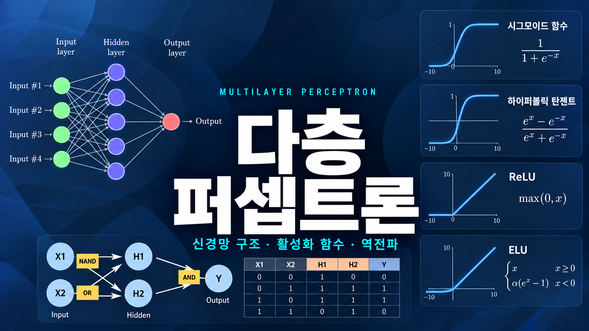
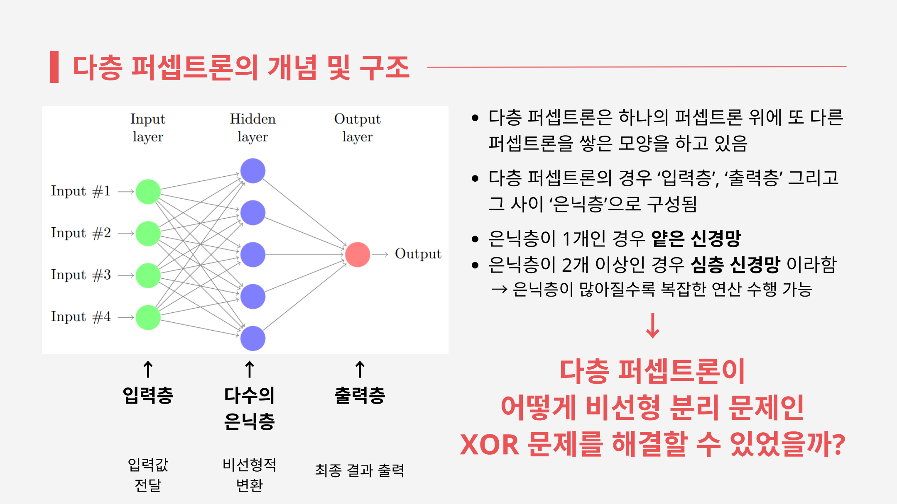
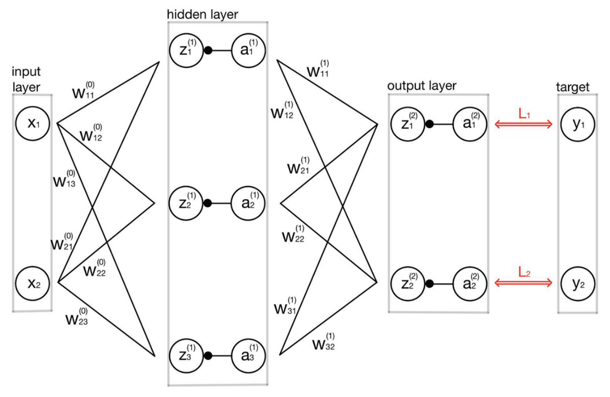

<h1 align="center">다층 퍼셉트론 발표 자료</h1>

다층 퍼셉트론의 구조, 활성화 함수, 역전파를 조사한 발표 자료

## Contents

* [프로젝트 소개](#프로젝트-소개)
* [은닉층과 XOR](#은닉층과-xor)
* [활성화 함수](#활성화-함수)
* [역전파](#역전파)
* [발표 자료](#발표-자료)

## 프로젝트 소개

부경대학교 인공지능 수업에서 다층 퍼셉트론(MLP)을 조사해 발표한 16쪽 분량의 자료입니다. 발표는 두 가지 질문에서 출발합니다. 직선 하나로 구분할 수 없는 XOR을 은닉층은 어떻게 표현할까요? 원하는 출력만 주어졌을 때 각 층의 가중치는 어떻게 학습할까요?

## 은닉층과 XOR

단층 퍼셉트론은 입력 공간을 직선 하나로 나누므로, 두 입력이 다를 때만 1이 되는 XOR을 표현할 수 없습니다. 다층 퍼셉트론은 입력층과 출력층 사이에 은닉층을 둡니다.

XOR을 NAND, OR, AND의 조합으로 분해했습니다. 은닉층의 두 뉴런이 같은 입력으로 NAND와 OR를 계산하고, 출력층이 두 결과를 AND로 묶으면 XOR이 됩니다. 오른쪽 진리표에서 두 입력이 모두 1인 행을 보면, 은닉층의 NAND는 0이고 OR는 1입니다. 출력층은 두 값 중 하나가 0이므로 0을 냅니다. 두 입력이 서로 다를 때만 NAND와 OR가 모두 1이 되어 최종 출력도 1이 됩니다.

다만 층을 쌓는 것만으로는 충분하지 않습니다. 선형 연산을 여러 번 합성해도 결과는 하나의 선형 연산이므로, 각 층의 출력을 비선형 함수로 바꿔야 은닉층을 둔 의미가 생깁니다. 이것이 다음 주제인 활성화 함수로 이어집니다.

## 활성화 함수

네 가지 활성화 함수를 출력 범위와 학습에 미치는 영향으로 비교했습니다.

<table width="100%">
  <thead>
    <tr>
      <th align="left">함수</th>
      <th align="left">출력</th>
      <th align="left">학습에서의 한계</th>
    </tr>
  </thead>
  <tbody>
    <tr>
      <td>Sigmoid</td>
      <td>0에서 1 사이</td>
      <td>입력의 절댓값이 크면 기울기가 0에 가까워짐</td>
    </tr>
    <tr>
      <td>Tanh</td>
      <td>-1에서 1 사이, 원점 대칭</td>
      <td>Sigmoid와 같은 포화 구간의 기울기 소실</td>
    </tr>
    <tr>
      <td>ReLU</td>
      <td>양수는 그대로, 음수는 0</td>
      <td>음수 구간에 머문 뉴런은 기울기가 0이 되어 학습이 멈춤(Dying ReLU)</td>
    </tr>
    <tr>
      <td>ELU</td>
      <td>양수는 그대로, 음수는 지수 함수로 완만하게</td>
      <td>음수 구간에도 기울기가 있지만 지수 연산 비용이 듦</td>
    </tr>
  </tbody>
</table>

그래프에서 Sigmoid의 양 끝은 거의 수평이고, ReLU의 양수 구간은 기울기가 1인 직선입니다. 이 차이는 학습할 때 중요합니다. 역전파에서는 출력층에서 은닉층으로 거슬러 가며 각 단계의 미분값을 곱합니다. Sigmoid의 평평한 구간처럼 작은 미분값이 여러 층에서 계속 곱해지면 앞쪽 층에 전달되는 기울기가 작아져 가중치가 거의 바뀌지 않습니다. 이를 기울기 소실이라고 합니다.

## 역전파

그림을 왼쪽에서 오른쪽으로 따라가면 **순전파**입니다. 두 입력이 가중치가 표시된 연결선을 따라 은닉층에 들어갑니다. 각 뉴런은 가중합에 활성화 함수를 적용해 다음 층으로 보낼 값을 구합니다. 출력층에서는 두 예측값을 각각 목표값과 비교하고, 두 출력의 손실을 합쳐 전체 손실을 구합니다.

은닉층에는 직접 비교할 정답이 없습니다. 대신 **역전파**는 전체 손실에서 출발해 각 가중치가 손실에 미치는 영향을 계산합니다. 그림 가운데 은닉 뉴런 하나를 고르면 두 출력 뉴런 모두와 연결되어 있습니다. 따라서 그 은닉 뉴런으로 들어오는 가중치의 기울기를 구하려면 두 출력으로 이어지는 경로의 기여를 모두 더해야 합니다. 이 계산을 연쇄법칙에 따라 출력층에서 입력층 방향으로 수행합니다.

경사 하강법은 이렇게 구한 기울기에 학습률을 곱해 각 가중치에서 뺍니다. 기울기가 양수면 가중치를 줄이고, 음수면 늘립니다. 갱신한 가중치로 다시 순전파해 손실을 계산하면서 학습을 반복합니다.

처음의 XOR 예제에서는 NAND와 OR를 은닉층에 배치해 **어떤 중간 결과가 있으면 XOR을 표현할 수 있는지** 보였습니다. 은닉층과 비선형 활성화 함수는 그런 표현을 가능하게 합니다. 데이터에서 가중치를 학습할 때는 입력과 목표 출력을 주고, 역전파로 계산한 기울기에 따라 각 층의 가중치를 조정합니다.

## 발표 자료

[다층 퍼셉트론 조사 보고서.pdf](다층%20퍼셉트론%20조사%20보고서.pdf)
